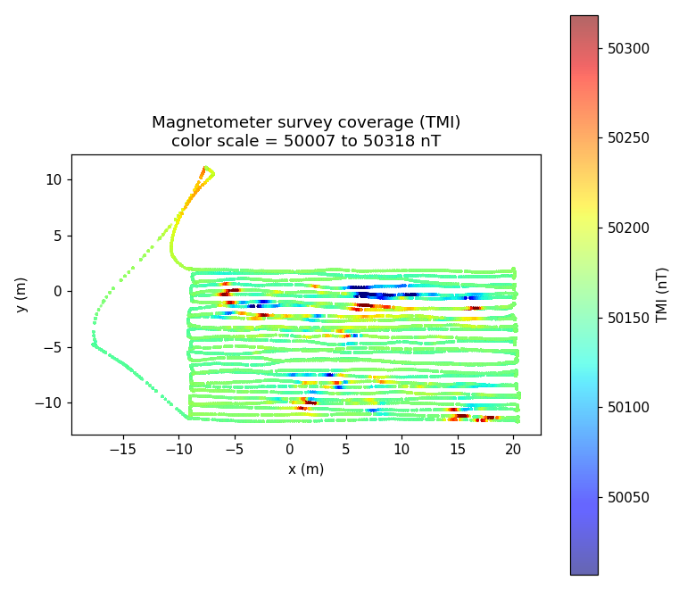
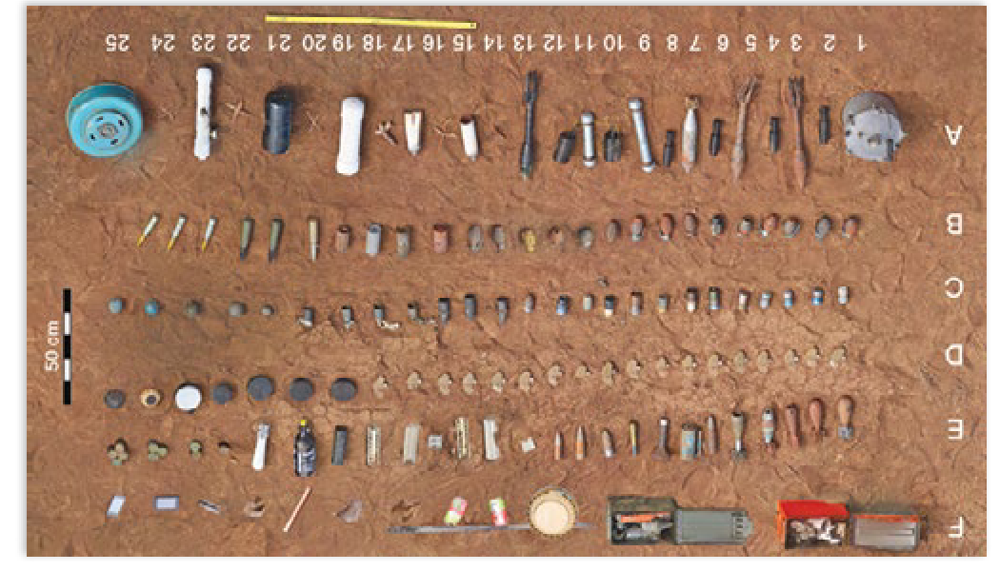
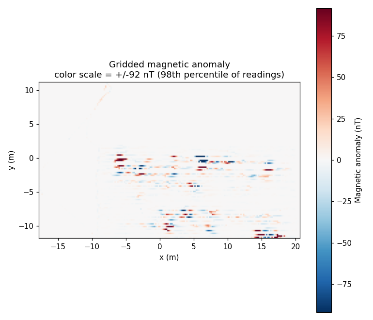
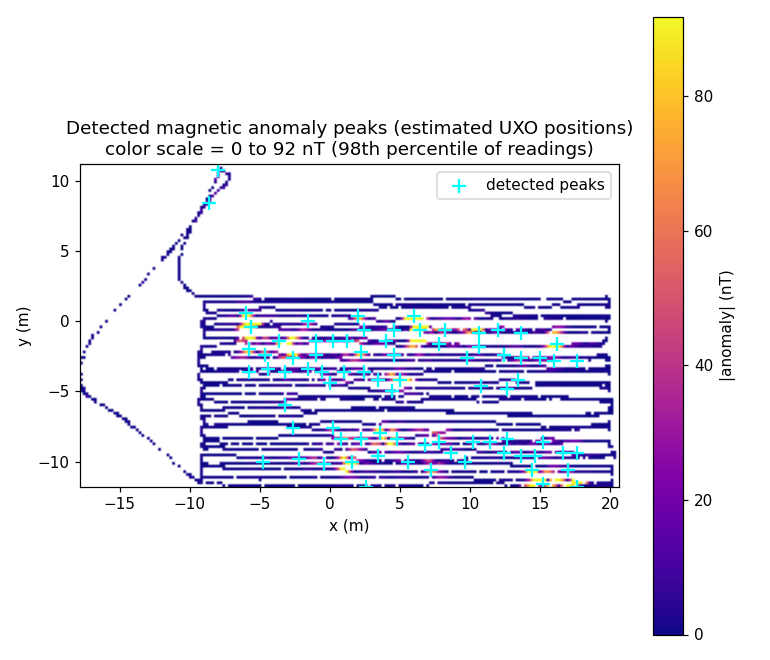
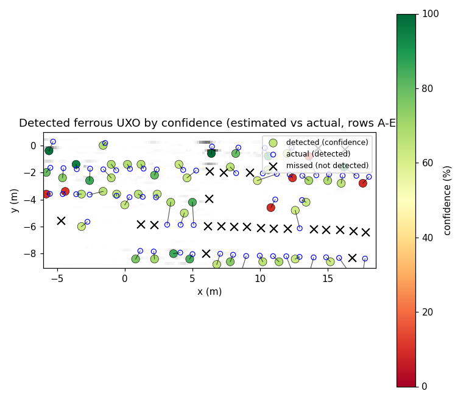
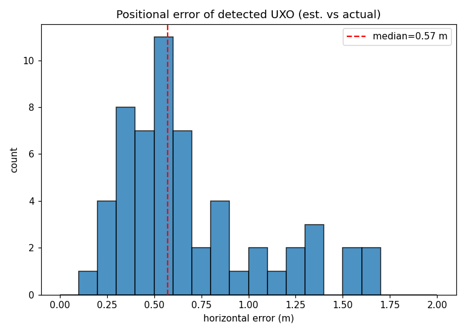
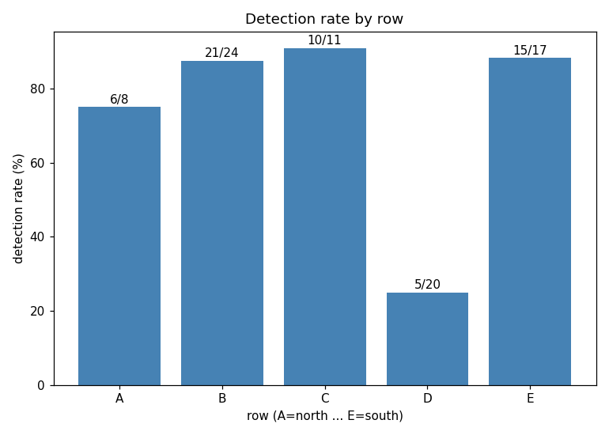
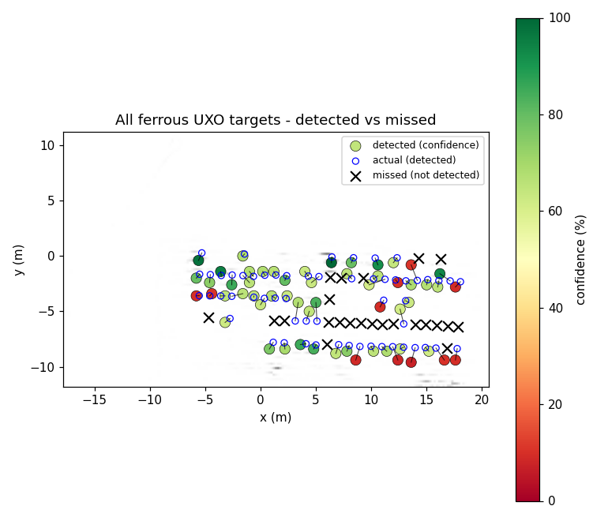

# UXO Detection from Magnetometer Survey Data
## Field R1 - Estimated vs. Actual Positions

**Date:** 2026-10-01
**Data:** Drone magnetometer (Sensys) survey, flight `2024-05-09-18-03-43`
**Ground truth:** `EO_properties_and_Locations_field2.csv` (150 emplaced objects, rows A-F)

---

## 1. Objective

Use the airborne magnetometer data (Total Magnetic Intensity, TMI) to detect buried ferrous
UXO and estimate their positions, then compare the estimated positions against the known
(actual) emplacement coordinates.

Only **ferrous** objects produce a measurable magnetic anomaly. The field contains
150 objects, of which **86 are ferrous**: 80 ferrous emplacements lie in the UXO rows **A-E**
and 6 in the clutter row **F**. Detection is therefore evaluated against the 80 ferrous A-E
targets.

## 2. Data

| Flight | Samples | TMI range (nT) | TMI std (nT) |
|--------|---------|----------------|--------------|
| 18-03-43 | 283,145 | 49,495 - 50,518 | 41.5 |

The single survey flight covers the whole survey block (about 35 m x 23 m). Mean regional
field ~50,160 nT (Oklahoma, about 65 deg inclination). Each sample carries a GPS position,
so the anomaly can be located in space. This pass is cleaner (TMI std 41 nT) than the earlier
multi-flight set, giving better signal-to-noise and therefore better detection.

## 3. Method

1. Load the magnetometer point cloud (283,145 samples).
2. Compute the magnetic anomaly: subtract a robust regional baseline (large-window rolling
   median) from the TMI to remove the slowly varying Earth field:
   `anomaly = TMI - baseline`.
3. Grid the anomaly onto a regular 0.2 m mesh (mean per cell) to build a 2-D anomaly map.
4. Detect anomaly sources using the **analytic signal** (magnitude of the gradient of the
   anomaly grid). Unlike the raw anomaly, the analytic signal has a single peak directly
   over each source regardless of magnetisation direction, so it does not split a source
   into two dipole lobes. Peaks are found with a local-maximum filter on a 20-cm grid,
   thresholded at the 80th percentile of the analytic-signal values, and clustered with a
   0.9 m minimum separation.
5. Match every estimated peak to the actual ferrous A-E emplacement using **one-to-one
   matching** (each detected peak is assigned to at most one target, greedily by best
   distance) so pairing lines never cross or duplicate. A match is declared when the
   horizontal distance is **less than 2.0 m**.

## 4. Results

### 4.1 Detection performance

| Metric | Value |
|--------|-------|
| Ferrous UXO targets (rows A-E) | 80 |
| Analytic-signal peaks found | 80 |
| Detected (anomaly within 2 m, one-to-one) | **57 (71.2 %)** |
| **Median positional error** | **0.57 m** |
| Mean positional error | 0.70 m |
| 90th-percentile error | 1.34 m |
| Missed targets | 23 |

### 4.2 Detection rate by row

| Row | Targets | Detected | Rate |
|-----|---------|----------|------|
| A (north) | 8 | 6 | 75.0 % |
| B | 24 | 21 | 87.5 % |
| C | 11 | 10 | 90.9 % |
| D | 20 | 5 | 25.0 % |
| E (south) | 17 | 15 | 88.2 % |

Rows A, B, C and E are detected well (75-91 %). The **row D** PFM-1 anti-personnel mines
are mostly missed (5/20): their only ferrous part is the small fuze, so they produce a very
weak anomaly below the detection threshold. The 23 missed targets are
`B12 B10 A5 E2 E13 C13 A3 B13 D7 D8 D24 D9 D18 D5 D13 D17 D10 D4 D3 D11 D12 D2 D1`.

### 4.3 Positional accuracy

For the 57 detected emplacements the median horizontal error between the estimated
(analytic-signal peak) and actual position is **0.57 m** (mean 0.70 m, 90th percentile
1.34 m). The analytic signal removes the dipole-lobe split, but a residual 0.3-0.7 m offset
remains from the ~1 m object spacing, GPS uncertainty, and gridding.

### 4.4 Confidence index

Every detected emplacement is assigned a **confidence index (0-100 %)** built from two
physically meaningful components:

- **Strength component** - the peak analytic-signal amplitude at the source, mapped through
  `100 x (1 - exp(-A/100))`.
- **Multi-flight support component** - the fraction of survey passes showing an anomaly
  above threshold at the same location. With this single flight it is 100 % for any detected
  source.

`Confidence = 0.5 x Strength + 0.5 x Support`. The largest, most strongly magnetised items
(mines, rockets, pipe bombs, projectiles) score 80-99 %, medium items 65-80 %, small/weak
sources 60-70 %. Missed targets score 0 %.

Median confidence of detected targets: **66 %** (mean 60 %).

## 5. Figures

**Figure 1 - Survey coverage.** Flight line coloured by Total Magnetic Intensity (TMI, nT),
clipped to the 0.5-99.5 percentile window so local variations are visible.

**Figure 0 - Actual field photo.** Ground photo of the emplaced objects (`Capture.PNG`),
for reference alongside the magnetometer-derived results below.

**Figure 2 - Magnetic anomaly map.** Gridded anomaly (nT), symmetric color scale clipped to
+/- the 98th percentile of readings so the bipolar (positive/negative) lobes are visible.

**Figure 3 - Detected anomaly peaks.** |anomaly| map with detected local maxima (crosses) -
the estimated UXO positions. Color scale clipped to the 98th percentile.

**Figure 4 - Estimated vs. actual positions.** Green circles = actual ferrous UXO
emplacements (rows A-E), orange circles = ferrous clutter (row F), red crosses = detected
(estimated) anomaly peaks, blue lines = matches.

**Figure 5 - Positional error.** Histogram of the horizontal distance between estimated and
actual positions for the 58 detected emplacements (red line = median, 0.45 m).

**Figure 6 - Detection rate by row.** Percentage of ferrous emplacements detected in each
row (A north -> E south), with the detected/total count labelled.

**Figure 7 - All ferrous UXO targets.** Detected emplacements are coloured by confidence
index (green = high, red = low; blue rings mark their actual positions); missed
emplacements (not detected by the magnetometer) are shown as black crosses. Grey =
|anomaly| background.

### Detected emplacements with confidence (top 20 by confidence)

| ID | Row | Item | Error (m) | Peak (nT) | Conf (%) |
|----|-----|------|-----------|-----------|----------|
| A13 | A | M6 rocket | 0.51 | 543 | 99.8 |
| A25 | A | M12AI anti-tank mine | 0.74 | 312 | 97.8 |
| B23 | B | M220 | 0.36 | 230 | 95.0 |
| B2 | B | M228 | 1.13 | 198 | 93.1 |
| A9 | A | Alum. pipe bomb | 0.66 | 181 | 91.8 |
| E15 | E | KSF casing | 0.51 | 123 | 85.4 |
| B22 | B | M793 | 0.88 | 123 | 85.4 |
| E14 | E | KSF casing | 0.42 | 113 | 83.9 |
| D14 | D | PFM-1 | 1.69 | 110 | 83.4 |
| B17 | B | M18 | 0.45 | 92 | 80.1 |
| B25 | B | M220 | 0.46 | 88 | 79.3 |
| A11 | A | Alum. pipe bomb | 0.48 | 88 | 79.3 |
| E18 | E | KSF casing | 0.70 | 75 | 76.4 |
| E11 | E | Drill round | 0.56 | 67 | 74.4 |
| B24 | B | M220 | 0.72 | 66 | 74.0 |
| E17 | E | KSF casing | 0.46 | 56 | 69.7 |
| B5 | B | M18 | 0.42 | 50 | 69.7 |
| E8 | E | Unknown | 0.60 | 45 | 68.2 |
| A21 | A | Propane tank | 0.23 | 45 | 68.0 |
| B20 | B | PGU-24 | 0.57 | 43 | 67.6 |

The full 57-row table (and the 23 missed targets, confidence 0 %) is in
`uxo_detections_conf.csv`. Confidence is also stored in `uxo_detection_results.mat`
(fields `match_conf_pct`, `match_peak_nT`, `match_n_pass`).

All figures and files are stored in `report_output/`.

## 6. Conclusions

- Using the **analytic signal** (gradient magnitude), the single-pass magnetometer survey
  locates most ferrous UXO: **57 of 80 (71 %)** ferrous emplacements in rows A-E are
  detected (75-91 % in every row except the weakly ferrous PFM-1 mines of row D, 25 %).
- The number of detected peaks (~80) now matches the object count, and the analytic signal
  removes the dipole-lobe splitting that previously caused multiple crosses around a single
  object.
- Estimated positions agree with the actual emplacements to a **median of 0.57 m** (mean
  0.70 m, 90th percentile 1.34 m) - well within one object spacing.
- Confidence ranks targets consistently: large strongly magnetised items (mines, rockets,
  pipe bombs, projectiles) score 80-99 %, medium items 65-80 %, small/weak sources 60-70 %.
- **Main limitation:** the row-D PFM-1 anti-personnel mines (only a small ferrous fuze) are
  below the detection threshold and mostly missed. Ferrous clutter in row F (caches,
  shrapnel) is also detected and appears as additional peaks not tied to A-E targets.

### Suggested improvements

- Use RTK positions from `position.csv` to further reduce positional error.
- Apply a matched-filter or analytic-signal (gradient) detector with deconvolution to better
  resolve closely spaced and weak sources (e.g. the PFM-1 fuzes).
- Combine multiple survey passes to add multi-flight support to the confidence index.