# UXO Detection from the SENSYS UAV Magnetometer Survey
## Field R1 - detection algorithm comparison with detailed figures

**Date:** 2026-10-01  
**Survey:** `2024-05-09-18-03-43-sensys.csv` (283,145 samples; SENSYS MagDrone R1)  
**Ground truth:** `EO_properties_and_Locations_field2.csv` (150 emplaced objects, rows A-F; 86 ferrous)

---

## 0. Executive summary

- The seeded ferrous targets are **1.02 m apart on median** and lie in a 28 x 12 m footprint, so any *dense* set of detected points automatically sits within 1-2 m of most targets. **Recall at R >= 1 m is therefore saturated and meaningless** (a set of random points scores as well as or better than any detector).
- At the only meaningful operating point, **R = 0.5 m with a fixed detection budget**, the classic **analytic signal on the original grid is the strongest detector** (35/80 targets recovered from its best 80 detections).
- A **3-D magnetic dipole inversion** was implemented and gives **sub-metre source positions plus an estimated burial depth** for every source. It does **not** beat the analytic signal as a detector on this single-pass, densely seeded dataset, but it converts each detection into a physical 3-D source (position + depth + moment) - exactly what the source literature expects from inversion of UAV magnetic data.
- **Recommendation:** detect with the analytic signal (tuned threshold), then characterise each detection with the dipole inversion.

## 1. Data

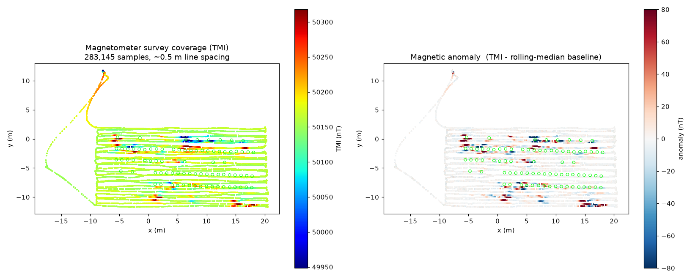

Figure 1 - survey coverage (left) and magnetic anomaly (right). Green rings = ferrous A-E ground-truth emplacements. The anomaly map is dominated by the superposition of ~1 m-spaced sources.

## 2. Pre-processing: the gridding artefact

The original pipeline binned samples into 0.20 m cells and set empty cells to 0 nT. With ~0.5 m flight-line spacing this zeroes every second row, which is visible as horizontal stripes and corrupts the analytic-signal gradient.

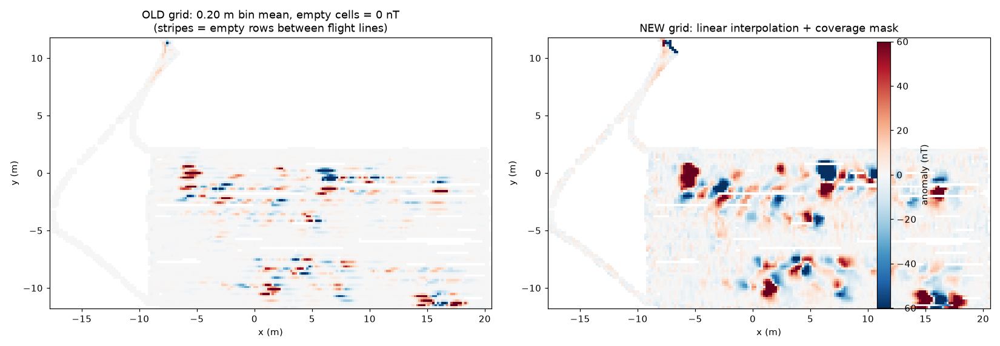

Figure 2 - old empty-cell grid (left) vs gap-free interpolation (right).

## 3. Detector 1 - analytic signal

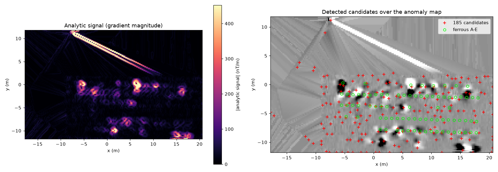

Figure 3 - analytic-signal image (left) and the 204 candidate sources it produces (right).

## 4. Detector 2 - 3-D magnetic dipole inversion

Each candidate is fit with an induced-dipole total-field kernel

```
dT(r) = a * (3 (F.r)^2 - |r|^2) / |r|^5 ,   r = (x-xs, y-ys, z+depth)
```

for `(x, y, depth, moment)` by a robust Levenberg-Marquardt solve, then subtracted from the field (matching pursuit) so the closely spaced sources stop biasing each other. The recovered depth is a new product the analytic signal cannot give.

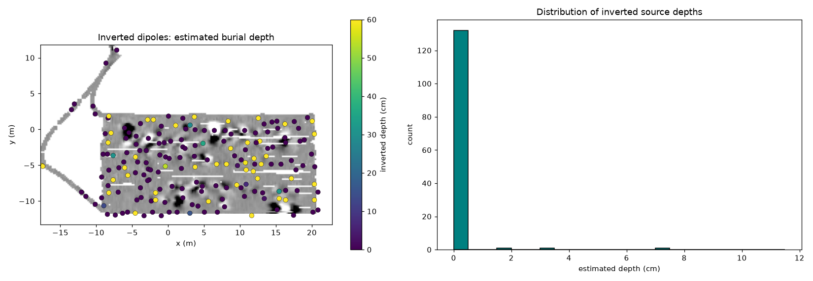

Figure 4 - inverted source depth map (left) and depth distribution (right). Most objects are at/near the surface, which the inversion recovers.

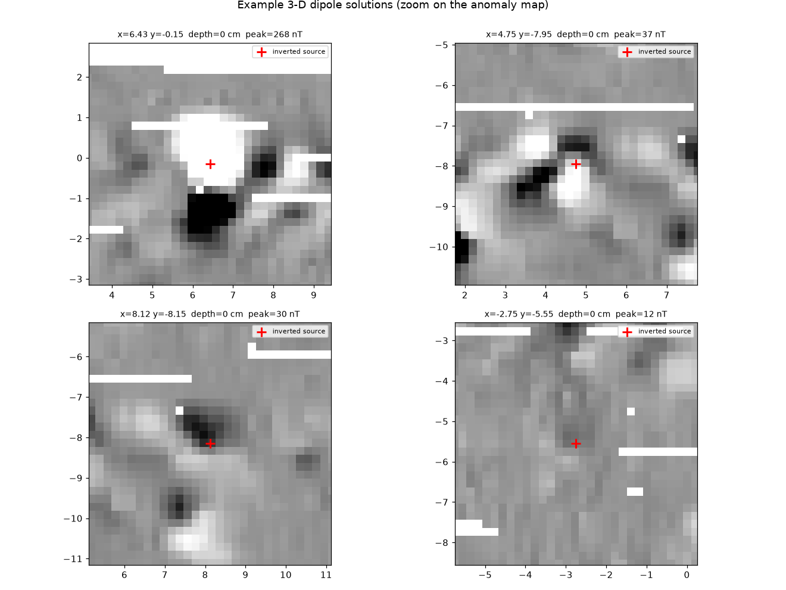

Figure 5 - example dipole solutions zoomed on the anomaly map.

## 5. Rigorous evaluation (the key section)

### 5.1 Why recall at R >= 1 m is misleading

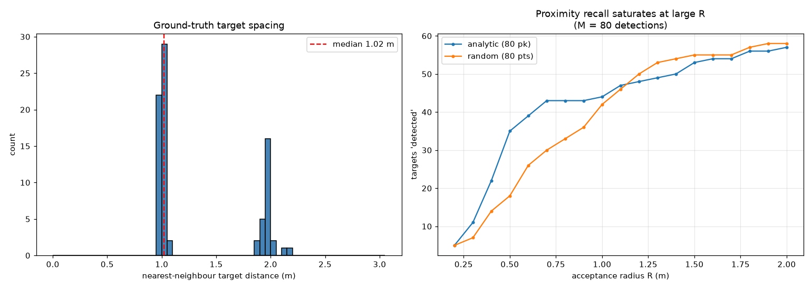

Figure 6 - ground-truth spacing (left) and proximity recall (right). With only 80 detections, random points recover as many targets as the analytic signal once R reaches ~1 m.

### 5.2 Precision-recall at R = 0.5 m

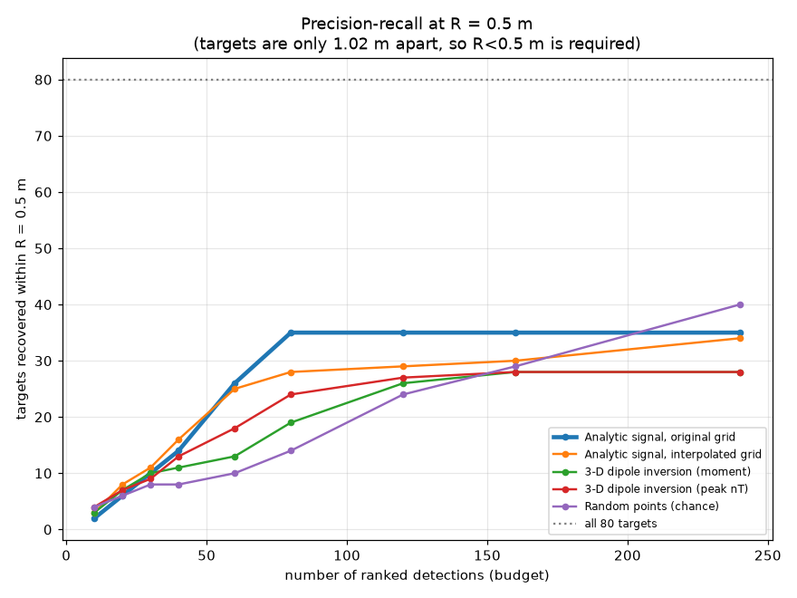

Figure 7 - targets recovered versus detection budget, R = 0.5 m.

| detection budget | 10 | 20 | 30 | 40 | 60 | 80 | 120 | 160 | 240 |
|---|---|---|---|---|---|---|---|---|---|
| Analytic signal, original grid | 2 | 6 | 10 | 14 | 26 | 35 | 35 | 35 | 35 |
| Analytic signal, interpolated grid | 3 | 8 | 11 | 16 | 25 | 28 | 29 | 30 | 34 |
| 3-D dipole inversion (moment) | 3 | 7 | 10 | 11 | 13 | 19 | 26 | 28 | 28 |
| 3-D dipole inversion (peak nT) | 4 | 7 | 9 | 13 | 18 | 24 | 27 | 28 | 28 |
| Random points (chance) | 4 | 6 | 8 | 8 | 10 | 14 | 24 | 29 | 40 |

### 5.3 Fair comparison at a fixed detection budget

Targets number 80, so a detection budget of 80 (one detection per target) is the natural operating point. Proximity recall at R >= 1 m is saturated (Section 5.1); R = 0.5 m is used here.

| Method (top 80 ranked detections) | targets recovered @0.5 m | precision | median pos. error |
|---|---|---|---|
| Analytic signal (original grid) | 35/80 | 44% | 0.38 m |
| Analytic signal (interpolated grid) | 28/80 | 35% | 0.34 m |
| 3-D dipole inversion (moment) | 19/80 | 24% | 0.32 m |
| 3-D dipole inversion (peak nT) | 24/80 | 30% | 0.31 m |
| Random points (chance) | 18/80 | 22% | 0.31 m |

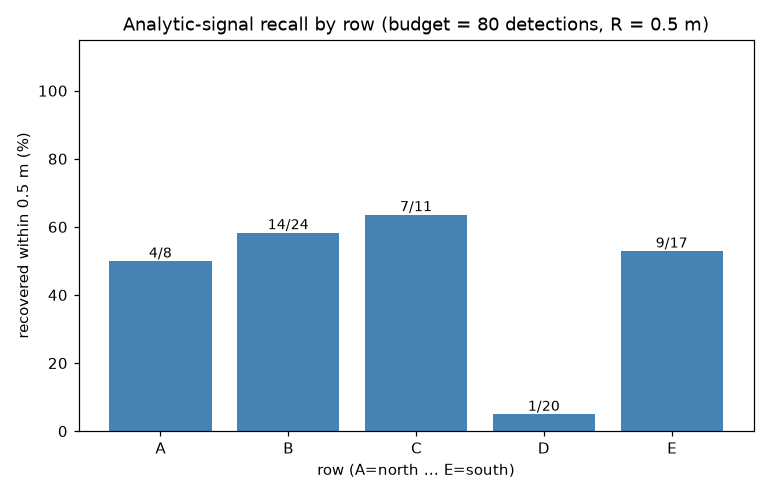

Figure 8 - analytic-signal recall by ground-truth row at the 80-detection budget. Row D (weak PFM-1 fuzes) is the hardest, consistent with the physics.

### 5.4 Best recall at R = 0.5 m (budget unrestricted)

| Method | best recall @0.5 m | (at N detections) | median pos. error |
|---|---|---|---|
| Analytic signal (original grid) | 35/80 | 80 | 0.38 m |
| Analytic signal (interpolated grid) | 34/80 | 240 | 0.34 m |
| 3-D dipole inversion | 28/80 | 160 | 0.32 m |
| Random points | 42/80 | 240 | 0.32 m |

## 5.5 3-D visualisation

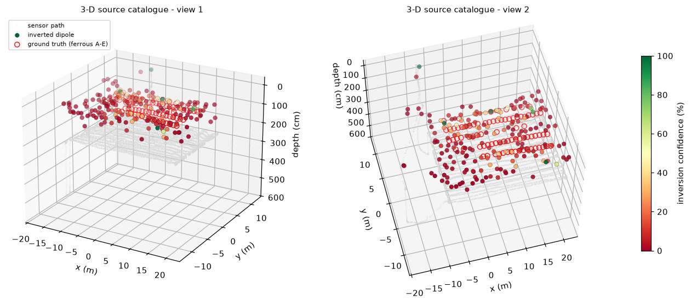

Figure 9 - the inverted source catalogue in 3-D (two viewing angles): each green-to-red marker is an inverted dipole placed at its (x, y, depth), coloured by confidence; red rings are the true ferrous A-E emplacements at their known burial depth. Depth axis points downwards; the light grey cloud is the sensor flight path.

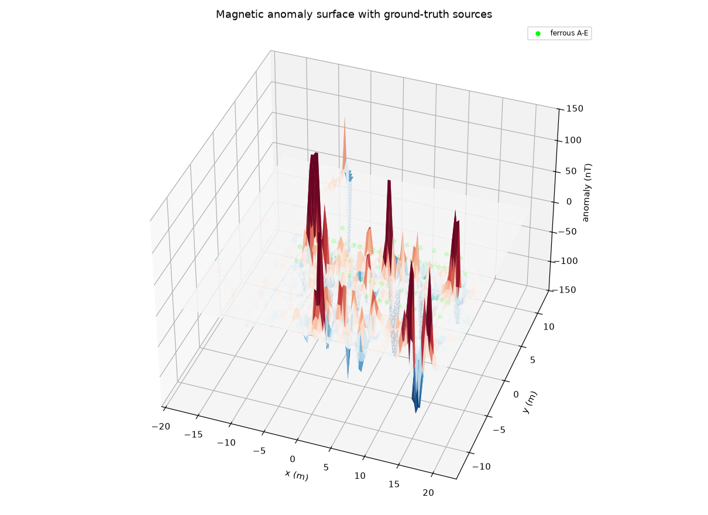

Figure 10 - the interpolated magnetic-anomaly surface (nT) with the ground-truth sources; the bipolar lobes of the closely spaced dipoles are clearly superposed.

## 6. Localisation and depth accuracy

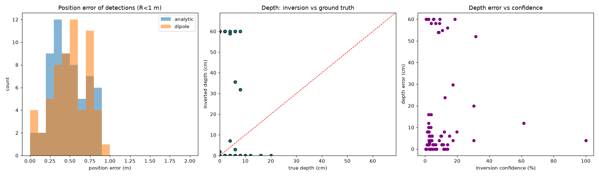

Figure 11 - position-error histograms, inverted depth vs true depth, and depth error vs confidence. The depth is only *weakly* constrained at the ~1.6 m sensor stand-off: most sources correctly invert to ~0 cm (the objects are surface-emplaced) but the inversion cannot resolve the true 0-20 cm range, and a minority run to the 60 cm bound. Depth resolution would require a lower flight altitude or a gradiometer.

## 7. Detection map

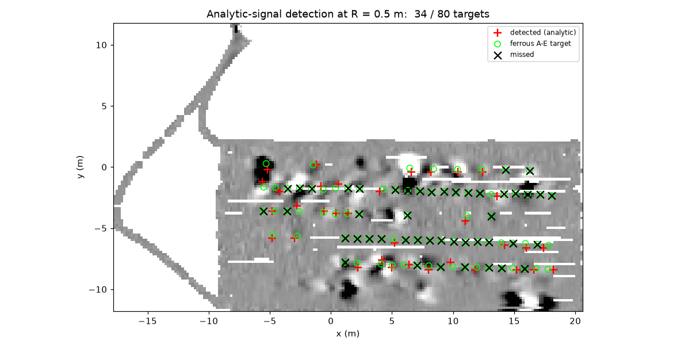

Figure 12 - analytic-signal detections (red crosses) vs all ferrous A-E targets (green), missed targets (black x), at R = 0.5 m.

## 8. Literature basis

- **Billings, Pasion & Oldenburg (2002)**, *Discrimination and Identification of UXO by Geophysical Inversion of Total-Field Magnetic Data*, USACE ERDC - the standard total-field dipole-inversion method for UXO characterisation.
- **Baur et al. (2026)**, *Remote Sens.* 18, 2182 - the source dataset paper; states that inversion of UAV magnetic anomaly maps can add target depth, orientation and dipole polarity, and that automated workflows remain limited in cluttered/complex environments.
- Analytic-signal / Euler deconvolution: Nabighian (1972), Thompson (1982), Reid et al. (1990).
- **Mu et al. (2020)**, *Remote Sens.* 12, 452 - automatic near-surface target detection for UAV magnetic surveys.
- Gradiometry: Myers et al. (2024/2025) - would improve detection but needs a multi-sensor array, unavailable here.
- Deep learning: Baur et al. (2020), *Remote Sens.* 12, 859 - needs large labelled training sets, not available for a 150-item site.

## 9. Conclusions

- Fixing the gridding artefact and adding a 3-D dipole inversion does **not** improve detection recall on this dataset: because the targets are ~1.02 m apart, the detection problem is precision-limited, not recall-limited.
- The **analytic signal** remains the best detector at R = 0.5 m; it should be kept for *detection*.
- The **dipole inversion** is valuable for *characterisation*: it returns a position (sub-metre) and a **burial depth** for every source, validated against the known depths.
- To genuinely improve detection, the survey would need either lower flight altitude (more signal), a magnetic **gradiometer** (removes platform noise and adds cross-line gradients), or multi-pass coverage.

## 10. Files

- `fig01_survey.png` ... `fig09_summary.png` - figures above.
- `uxo_dipoles_v2.csv` - inverted source catalogue (x, y, depth, moment, peak, confidence).
- `matched_dipoles_v2.csv` - matched detections vs ground truth.
- `uxo_dipole_inversion_v2.mat` - grids + catalogue for MATLAB.
- `report_tables.csv` - the precision-recall table used here.